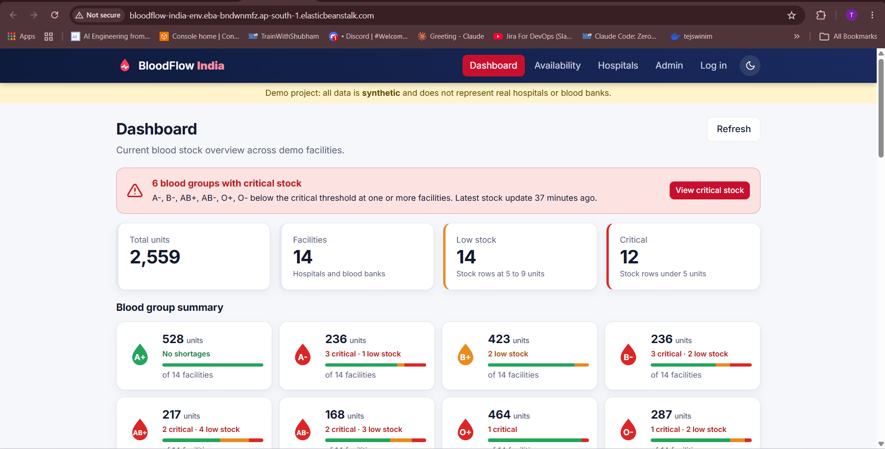
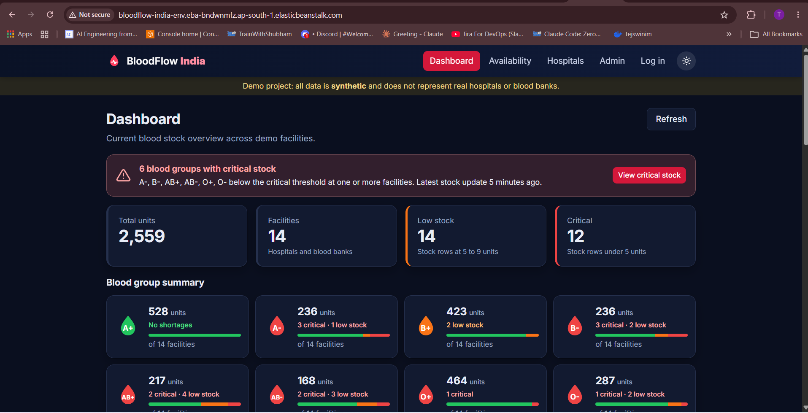
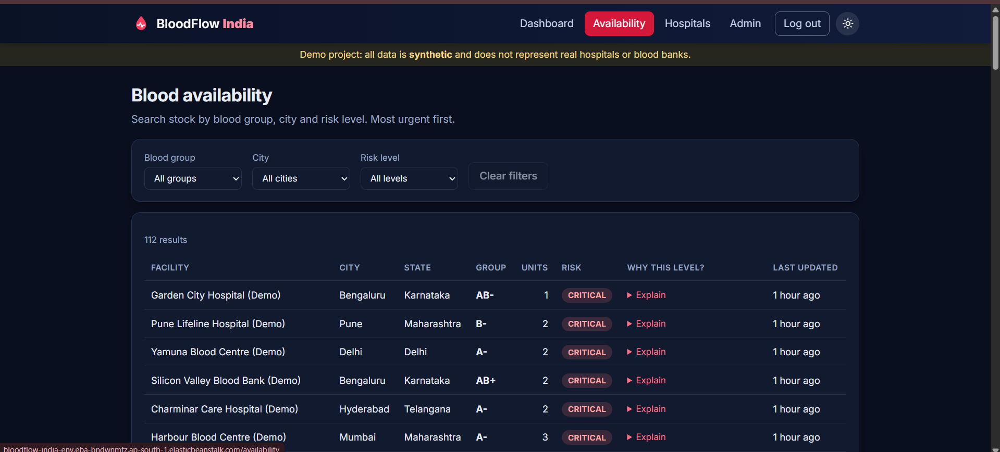
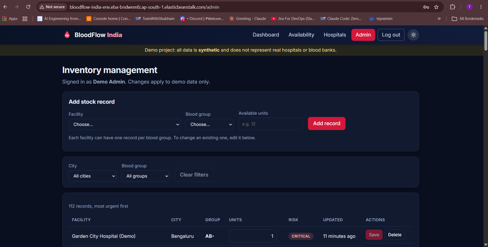
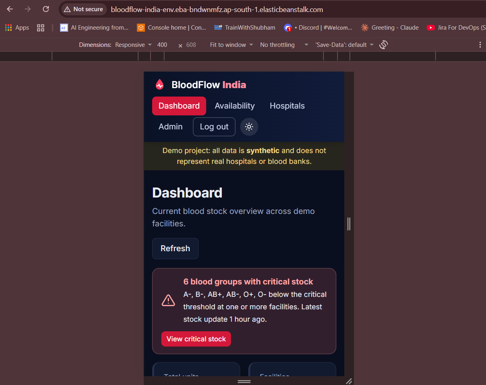
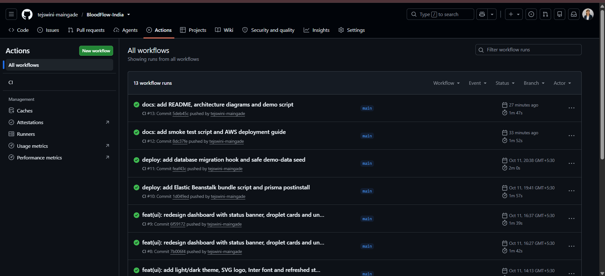
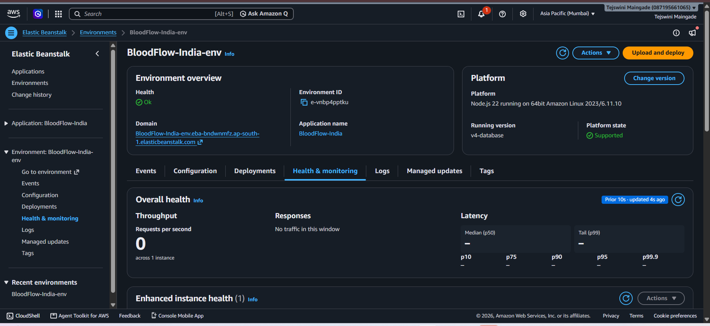
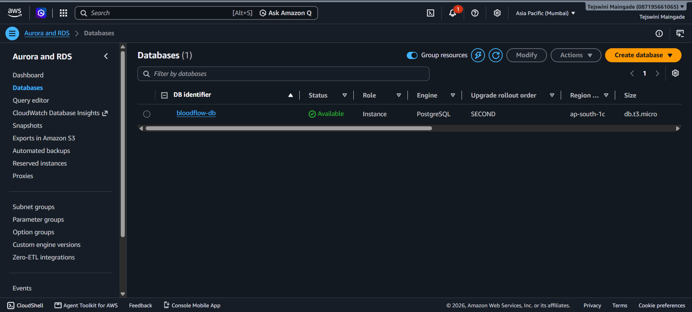

# BloodFlow India


**Monitor blood availability. Identify shortage risks. Respond faster.**

> **Demo project.** All data is **synthetic**. The facilities are fictional and do not represent real
> hospitals or blood banks. BloodFlow India does not provide real-time or medical data, and it does not
> claim to solve any blood shortage problem. The risk level comes from a simple rule-based demo model,
> not a medical prediction.

Built for the **Build on Elastic Beanstalk Hackathon by TrainWithShubham**.

**Live demo (while the AWS environment is running):**
http://BloodFlow-India-env.eba-bndwnmfz.ap-south-1.elasticbeanstalk.com

## Problem statement

Blood availability can change quickly because of emergencies, unpredictable demand and differences in
blood-group requirements. Hospitals and blood banks need clear visibility into current stock and
potential low-stock situations.

## Solution

A cloud-deployed web application that shows blood stock by blood group and location, flags low and
critical inventory with a transparent, configurable rule, and lets authorised administrators update stock.
It is a **working MVP and a DevOps showcase**: containerised, tested, scanned in CI and deployed on
AWS Elastic Beanstalk with an Amazon RDS PostgreSQL database.

## Features (MVP)

- **Dashboard:** total units, facilities, low-stock and critical counts, blood-group summary cards,
  units-by-group chart, risk distribution, location overview, recent updates, recent alerts
- **Availability search:** filter by blood group, city and risk level (filters live in the URL)
- **Shortage-risk detection:** configurable thresholds in one place, with a plain-language reason for every level
- **Facilities:** hospitals and blood banks with a stock summary and a detail page
- **Admin:** JWT login; add, update and delete inventory with validation and confirmation; the risk change is shown after each save
- **Alerts:** created when stock becomes HIGH or CRITICAL or gets worse
- **Light and dark themes**, responsive layout, tables that turn into cards on phones
- **`GET /health`** endpoint

### Risk model (defaults, configurable by environment variables)

| Units | Level |
|---|---|
| 20 or more | LOW |
| 10 to 19 | MEDIUM |
| 5 to 9 | HIGH |
| fewer than 5 | CRITICAL |

The dashboard "Low stock" count is the number of HIGH rows, and "Critical" is the number of CRITICAL rows.

## Architecture

See [docs/architecture.md](docs/architecture.md) for diagrams.

```
Internet -> Elastic Beanstalk (nginx -> Express API + React build) -> Amazon RDS PostgreSQL
```

## Tech stack

| Layer | Technology |
|---|---|
| Frontend | React, Vite, React Router, Vitest |
| Backend | Node.js 22, Express, Zod, JWT, bcryptjs |
| Database | PostgreSQL 16, Prisma 6 |
| Containers | Docker, Docker Compose |
| CI | GitHub Actions, npm audit, Trivy |
| Cloud | AWS Elastic Beanstalk, Amazon RDS, CloudWatch |

## Project structure

```
frontend/            React app (components, pages, services, hooks, utils)
backend/
  src/               controllers, routes, services, middleware, validators, config
  prisma/            schema, migrations, seed scripts
  tests/             Jest + Supertest tests
.platform/hooks/     Elastic Beanstalk deploy hook (migrations + safe seed)
scripts/             make-bundle.sh (deployment zip), smoke-test.sh
docs/                api.md, architecture.md, deployment.md, screenshots
.github/workflows/   ci.yml
docker-compose.yml
```

## Local setup

Requirements: Node.js 22, Docker.

```bash
git clone https://github.com/tejswini-maingade/BloodFlow-India.git
cd BloodFlow-India

docker compose up -d db                       # PostgreSQL

cd backend
cp .env.example .env                          # then set JWT_SECRET (openssl rand -hex 32) and ADMIN_*
npm install
npx prisma migrate dev                        # create tables
npm run db:seed                               # load SYNTHETIC demo data
npm run dev                                   # API on http://localhost:3000

cd ../frontend                                # in a second terminal
npm install
npm run dev                                   # http://localhost:5173 (proxies /api to :3000)
```

Single-process, production-style run:

```bash
cd frontend && npm run build
cd ../backend && npm start                    # API + React app on http://localhost:3000
```

### Environment variables (backend)

| Name | Purpose | Default |
|---|---|---|
| `PORT` | HTTP port | 3000 |
| `NODE_ENV` | `development`, `production` or `test` | development |
| `DATABASE_URL` | PostgreSQL connection string | none |
| `JWT_SECRET` | Token signing secret (16+ chars). The server refuses to start without it. | none |
| `JWT_EXPIRES_IN` | Token lifetime | 8h |
| `ADMIN_NAME`, `ADMIN_EMAIL`, `ADMIN_PASSWORD` | Demo admin created by the seed (password 10+ chars) | none |
| `CORS_ORIGIN` | Allowed frontend origin | http://localhost:5173 |
| `RISK_LOW_MIN`, `RISK_MEDIUM_MIN`, `RISK_HIGH_MIN` | Risk thresholds | 20, 10, 5 |
| `MAX_UNITS` | Maximum units per record | 500 |
| `FORCE_HTTPS` | Enable HSTS (only when served over HTTPS) | false |

`.env` files are git-ignored. Only `.env.example` files are committed.

## Docker

```bash
cp .env.example .env                          # set JWT_SECRET and admin values
docker compose up -d --build                  # db, backend (:3000), frontend (:8080)
docker compose exec backend node prisma/seed.js
docker compose ps
docker compose logs backend
docker compose down                           # add -v to also delete the database volume
```

Both containers run as non-root users. The backend runtime image contains no package manager.

## Testing

```bash
cd backend && npm test                        # 94 tests (Jest + Supertest, real PostgreSQL)
cd frontend && npm test                       # Vitest + Testing Library
```

Backend tests use a separate `bloodflow_test` database and refuse to run against any database whose
name does not contain "test".

```bash
docker exec bloodflow-db psql -U bloodflow -d bloodflow -c "CREATE DATABASE bloodflow_test;"   # once
cd backend && npm run db:migrate:test         # once, and after each schema migration
```

## API

Full reference: [docs/api.md](docs/api.md).

| Method | Path | Auth |
|---|---|---|
| GET | `/health` | public |
| POST | `/api/auth/login` | public (10 attempts / 15 min) |
| GET | `/api/blood`, `/api/blood/:id` | public |
| POST / PUT / DELETE | `/api/blood`, `/api/blood/:id` | admin |
| GET | `/api/hospitals`, `/api/hospitals/:id` | public |
| GET | `/api/dashboard`, `/api/alerts` | public |

## CI/CD

GitHub Actions runs on every push and pull request:

1. **Backend:** install, lint, migrate a PostgreSQL service database, tests, `npm audit`
2. **Frontend:** install, lint, tests, build, `npm audit`
3. **Trivy repository scan:** dependencies, secrets, Dockerfile misconfiguration
4. **Docker:** build both images and scan them with Trivy

**Failure policy:** the build fails only on HIGH or CRITICAL findings **that have a fix available**, and on
high or critical advisories in **production** npm dependencies. Everything else is printed in the logs but
does not fail the build. The Trivy action is pinned to a verified commit SHA. Exceptions go in `.trivyignore`
with a reason and review date.

Deployment to AWS is a deliberate manual step (zip upload) rather than automatic. Automatic deployment
is listed under future improvements.

## Security

- Helmet headers, CORS allow-list, rate limiting (300 requests per 15 min; 10 login attempts per 15 min)
- Zod validation on every input, repeated on the backend; unexpected fields are rejected
- Passwords hashed with bcrypt; JWT algorithm pinned to HS256; identical error for unknown user and wrong password
- Safe error handling: no stack traces in production responses
- No secrets in Git; production secrets are Elastic Beanstalk environment properties
- RDS is private and reachable only from the app's security group
- Dependency, secret and container scanning in CI

**Known limitations (honest list):**

- The site is served over **HTTP**. HTTPS needs a load balancer, a certificate and a domain.
- The database connection is encrypted, but the RDS certificate is **not verified** (`sslaccept=accept_invalid_certs`).
- Secrets are visible to anyone with access to the AWS account. AWS Secrets Manager is the stricter option.
- The public instance is scanned by bots (requests for `/.env` and similar appear in the nginx log); the app
  returns the home page for unknown paths and the deployment bundle contains no `.env` file.

## AWS deployment

Elastic Beanstalk (single instance, Node.js 22 on Amazon Linux 2023) plus Amazon RDS PostgreSQL 16
in Mumbai (`ap-south-1`). A `predeploy` hook applies migrations and loads the synthetic demo data only when
the database is empty. Full guide, resource list, cleanup steps and the problems solved during the first
deployment: [docs/deployment.md](docs/deployment.md).

```bash
./scripts/make-bundle.sh                      # build the deployment zip
./scripts/smoke-test.sh http://<domain>       # verify a deployment (9 checks)
```

## Monitoring

Elastic Beanstalk enhanced health reporting, CloudWatch Logs (app, nginx and engine logs, 7-day retention),
email notifications on health changes, and the smoke-test script.

## Screenshots

| | |
|---|---|
|  |  |
|  |  |
|  |  |
|  |  |

## Future improvements (not in the MVP)

- Role-based access control, email and SMS alerts, inventory history, blood expiry tracking
- Demand trend analysis, geographic shortage map, and forecasting once real verified data is connected
- HTTPS with a load balancer and ACM certificate; verify the RDS certificate with the RDS CA bundle
- Automatic deployment from GitHub Actions; AWS Secrets Manager; SHA-pinning of all GitHub Actions
- Upgrade to a newer Prisma major version; aggregate dashboard figures in SQL at larger scale

## License

MIT. Copyright (c) 2026 Tejswini-Maingade
