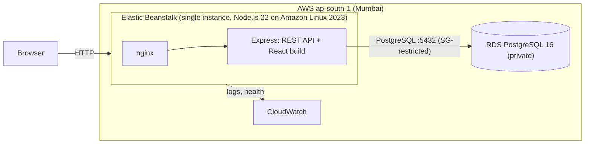
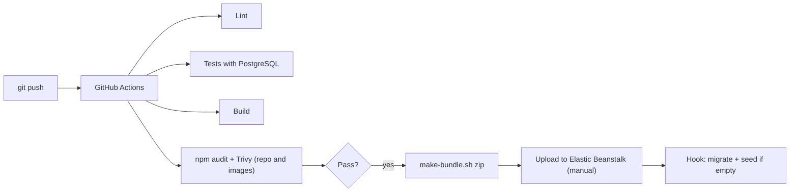
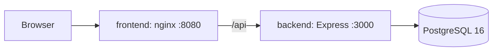

# Architecture

## Production (AWS)

## Delivery pipeline

## Local (Docker Compose)

## Key decisions

| Decision | Reason |
|---|---|
| Express serves the React build in production | One deployable unit, one Beanstalk environment, no CORS problems |
| Risk level computed, not stored | Changing a threshold never leaves stale data |
| Rule-based risk model | Transparent and explainable; the UI states it is a demo model, not a medical prediction |
| Single-instance environment | No load balancer cost; enough for a demo |
| RDS created separately from Beanstalk | The database survives environment rebuilds |
| Migrations in a `predeploy` hook | Schema changes apply before the new version starts; a failure keeps the old version serving |
| Seed only when the database is empty | A redeploy can never wipe edited data |
| Alerts only when stock gets worse | Raising stock does not create a warning |
